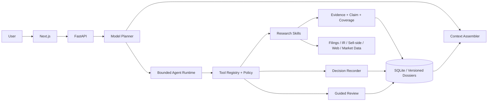

# 自渡 ThesisLoop

> AI Native 个人投资研究与复盘 Agent：把分散信息变成可回查的长期判断，把交易结果变成可复用的个人经验。  
> 研究用途，非投资建议；不输出确定性涨跌预测、收益承诺或直接买卖建议。

## 产品是什么

自主投资者的信息、当时判断、实际执行和事后复盘通常散落在行情软件、搜索、聊天和笔记里。自渡把它们连接成一条持续工作流：

```text
自然语言问题 → Agent 规划与调用工具 → 版本化 Research 档案
              → 用户确认 Decision → 模拟 Execution
              → 对照事前判断完成 Review → 用户确认 Pattern / Rule
```

比赛版聚焦一个核心任务：用户选择一家公司，完成一次有来源的研究，确认一条模拟投资决策，并基于新事实与模拟成交完成一次结构化复盘。

## 为什么是 Agent，而不是搜索框

这不是一次生成文本，而是会跨时间、会失败、需要权限控制的任务：

- LLM 理解用户意图、动态规划研究路径、阅读文档、比较版本并提出待验证项；
- Tools 获取财报、公告、行情、iFinD 和公开网页原文；
- Harness 管理 Context、Tool 权限、状态恢复、补搜和安全停止；
- 确定性代码计算财务指标、检查时点/引用/Coverage，并控制写入；
- Human in the Loop 在路径歧义、个人判断、复盘归因和长期规则写入处确认。

研究链路为 `Source → Evidence → Claim → Thesis`。搜索摘要和模型记忆只能提供线索，不能直接成为外部事实。

## 核心页面

| 页面 | 解决的问题 |
| --- | --- |
| Agent | 用自然语言发起研究、记录决策或开始复盘，并查看可核验执行轨迹 |
| Research | 维护公司 / 行业 / 事件的长期档案、变化、证据、冲突和缺口 |
| Review | 对照事前 Thesis、实际执行、新事实与 Outcome，由用户确认归因和经验 |

演示模式 `NEXT_PUBLIC_DEMO_MODE=1` 只展示这三个入口。

## 技术架构



公司研究是一个总控 Skill，并行调用五条原子证据通道：财报与公告、管理层交流、卖方预期、市场叙事、风险与反证。Planner 可以动态改变查询；Coverage Contract 保证“全面研究”不会随模型发挥漏掉必需模块。

详见 [产品方案](docs/PRODUCT.md) 与 [AI Native 架构](docs/ARCHITECTURE.md)。

## 数据来源

- 一手事实：巨潮资讯、公司公告/年报/季报、交易所与公司 IR；
- 市场数据：iFinD 可选，公开行情源自动降级；
- 预期与叙事：已打开的卖方材料、财经媒体与社区观点，均与公司事实分层；
- 本地状态：SQLite 保存研究版本、Decision、Execution、Review 和已确认 Memory。

公开 Demo 只含 6 个可再分发来源和合成交易数据，不包含作者的账户、持仓、交易或私人研究库。

## 快速启动

要求：Python 3.11+、Node.js 22+。

```bash
python -m venv .venv
source .venv/bin/activate
pip install -r requirements.txt

python scripts/init_competition_demo.py --db data/competition-demo.db
SA_DB_PATH=data/competition-demo.db \
SA_CORS_ORIGINS=http://localhost:3000 \
SA_DEMO=1 \
python -m uvicorn app.api.main:app --host 0.0.0.0 --port 8787
```

另开终端：

```bash
cd web
npm ci
NEXT_PUBLIC_API_BASE=http://localhost:8787 \
NEXT_PUBLIC_DEMO_MODE=1 \
npm run dev
```

访问 [http://localhost:3000/agent](http://localhost:3000/agent)。无需模型密钥即可查看预置 Research 与 Review；联网重新研究需要兼容 OpenAI API 的模型配置。

也可使用：

```bash
docker compose -f docker-compose.demo.yml up --build
```

## 环境变量

复制 `.env.example`，真实密钥只放部署平台 Secret，不提交到 Git：

| 变量 | 作用 |
| --- | --- |
| `OPENAI_API_KEY` / `OPENAI_BASE_URL` | OpenAI-Compatible 模型连接 |
| `LLM_MODEL` | 意图、逐篇阅读与 Claim 抽取 |
| `RESEARCH_LLM_MODEL` | 研究规划与最终跨来源综合 |
| `IFIND_MCP_TOKEN` | 可选 iFinD 专业数据层 |
| `SA_DB_PATH` | 隔离的 SQLite 路径 |
| `SA_CORS_ORIGINS` | 允许的 Web Origin，逗号分隔 |
| `NEXT_PUBLIC_API_BASE` | 浏览器访问的 API 地址 |
| `NEXT_PUBLIC_DEMO_MODE` | `1` 时启用比赛产品切片 |

## Eval 与测试

2026-10-11 本地结果：

| 评测 | 结果 |
| --- | ---: |
| Research Eval | 32/32，通过；6 类可信性门禁 0 失败 |
| Decision Recorder Gate | 44/44，通过 |
| Guided Review Eval | 30/30，通过 |
| Memory Eval | 30/30，通过 |
| 单元 / 集成测试 | 537/537，通过 |
| Next.js production build | 通过 |
| npm dependency audit | 0 vulnerability |

复现：

```bash
python -m evals.research.runner --model fixture
python -m evals.recorder.runner --model heuristic --set gate
python -m evals.review.runner
python -m evals.memory.runner
python -m unittest discover -s tests -p 'test_*.py'
```

这些数字只表示固定回归集通过，不代表线上任意问题正确率或投资收益。详见 [评测与测试记录](docs/EVAL_TEST.md)。

## 隐私与安全导出

当前个人工作仓库包含真实本地数据，不应直接公开。比赛仓库由显式白名单生成：

```bash
python scripts/build_competition_export.py /tmp/thesisloop-public
```

导出器拒绝 `.env`、数据库、缓存、个人交易目录、原始行情、私钥与本机绝对路径。部署与隐私说明见 [PRIVACY_DEPLOYMENT](docs/PRIVACY_DEPLOYMENT.md)。

## 已知边界与未做事项

- 公开 Demo 的研究覆盖刻意标为 `PARTIAL`，因为未携带受限来源和实时行情；
- 搜索、网页读取与模型输出仍受网络、权限、付费墙和供应商稳定性影响；
- 当前为单用户 SQLite 原型，尚无账号、团队权限和云同步；
- 未验证投资收益，也未完成 3—5 名外部目标用户可用性测试；
- 行业/事件每日自动跟踪、组合归因与机构协作不在本次核心主链路。

## 文档

- [产品方案](docs/PRODUCT.md)
- [用户研究与问题证据](docs/USER_RESEARCH.md)
- [AI Native 与技术架构](docs/ARCHITECTURE.md)
- [AI 使用与验证记录](docs/AI_USAGE.md)
- [评测与测试记录](docs/EVAL_TEST.md)
- [演示与提交说明](docs/DEMO.md)
